<!-- ARAXIS07 / Developer Index. Generated by scripts/build_profile.py. -->

<picture>
  <source media="(prefers-color-scheme: dark) and (max-width: 600px)" srcset="assets/index/dark/mobile/header.svg" />
  <source media="(max-width: 600px)" srcset="assets/index/light/mobile/header.svg" />
  <source media="(prefers-color-scheme: dark)" srcset="assets/index/dark/desktop/header.svg" />
  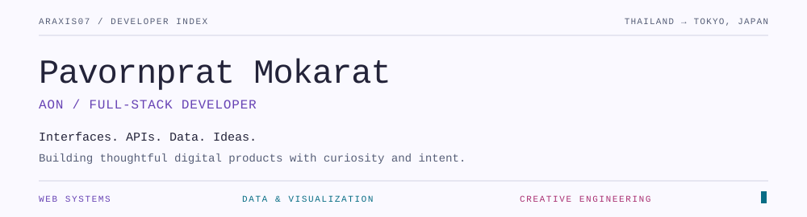
</picture>

 

<picture>
  <source media="(prefers-color-scheme: dark) and (max-width: 600px)" srcset="assets/index/dark/mobile/s01.svg" />
  <source media="(max-width: 600px)" srcset="assets/index/light/mobile/s01.svg" />
  <source media="(prefers-color-scheme: dark)" srcset="assets/index/dark/desktop/s01.svg" />
  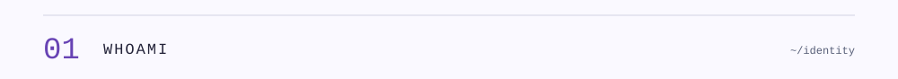
</picture>

<picture>
  <source media="(prefers-color-scheme: dark) and (max-width: 600px)" srcset="assets/index/dark/mobile/whoami.svg" />
  <source media="(max-width: 600px)" srcset="assets/index/light/mobile/whoami.svg" />
  <source media="(prefers-color-scheme: dark)" srcset="assets/index/dark/desktop/whoami.svg" />
  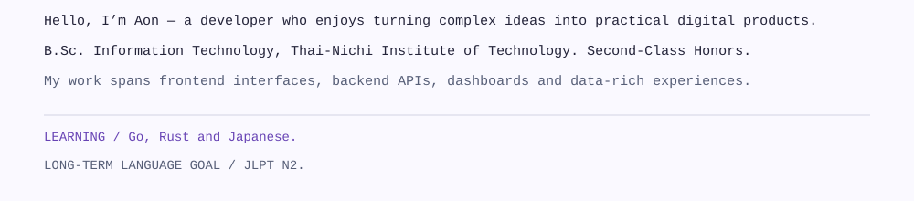
</picture>

<picture>
  <source media="(prefers-color-scheme: dark) and (max-width: 600px)" srcset="assets/index/dark/mobile/s02.svg" />
  <source media="(max-width: 600px)" srcset="assets/index/light/mobile/s02.svg" />
  <source media="(prefers-color-scheme: dark)" srcset="assets/index/dark/desktop/s02.svg" />
  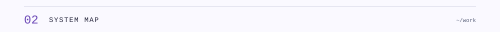
</picture>

<picture>
  <source media="(prefers-color-scheme: dark) and (max-width: 600px)" srcset="assets/index/dark/mobile/ecosystem.svg" />
  <source media="(max-width: 600px)" srcset="assets/index/light/mobile/ecosystem.svg" />
  <source media="(prefers-color-scheme: dark)" srcset="assets/index/dark/desktop/ecosystem.svg" />
  
</picture>

<picture>
  <source media="(prefers-color-scheme: dark) and (max-width: 600px)" srcset="assets/index/dark/mobile/s03.svg" />
  <source media="(max-width: 600px)" srcset="assets/index/light/mobile/s03.svg" />
  <source media="(prefers-color-scheme: dark)" srcset="assets/index/dark/desktop/s03.svg" />
  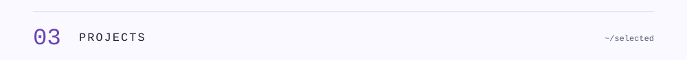
</picture>

<a href="https://github.com/araxis07/Siam-Luxe">
<picture>
  <source media="(prefers-color-scheme: dark) and (max-width: 600px)" srcset="assets/index/dark/mobile/project-01.svg" />
  <source media="(max-width: 600px)" srcset="assets/index/light/mobile/project-01.svg" />
  <source media="(prefers-color-scheme: dark)" srcset="assets/index/dark/desktop/project-01.svg" />
  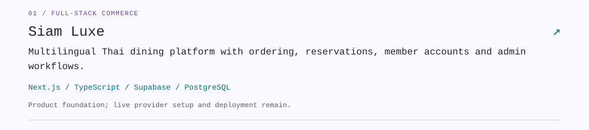
</picture>
</a>

<a href="https://github.com/araxis07/AI-Knowledge">
<picture>
  <source media="(prefers-color-scheme: dark) and (max-width: 600px)" srcset="assets/index/dark/mobile/project-02.svg" />
  <source media="(max-width: 600px)" srcset="assets/index/light/mobile/project-02.svg" />
  <source media="(prefers-color-scheme: dark)" srcset="assets/index/dark/desktop/project-02.svg" />
  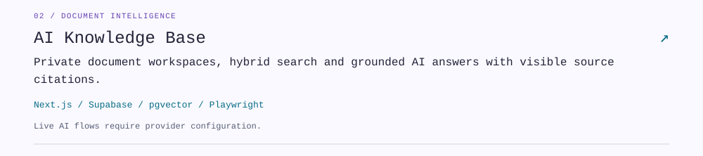
</picture>
</a>

<a href="https://github.com/araxis07/Nexus-Tech">
<picture>
  <source media="(prefers-color-scheme: dark) and (max-width: 600px)" srcset="assets/index/dark/mobile/project-03.svg" />
  <source media="(max-width: 600px)" srcset="assets/index/light/mobile/project-03.svg" />
  <source media="(prefers-color-scheme: dark)" srcset="assets/index/dark/desktop/project-03.svg" />
  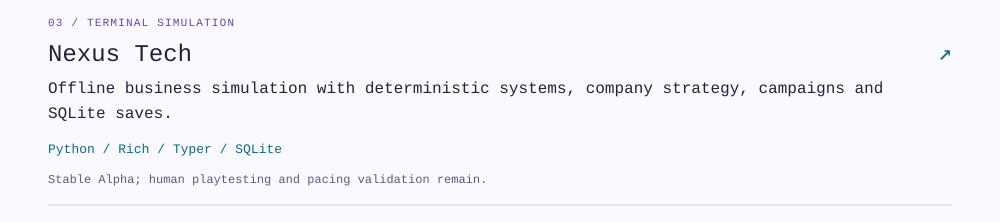
</picture>
</a>

<a href="https://github.com/araxis07/finance-dashboard">
<picture>
  <source media="(prefers-color-scheme: dark) and (max-width: 600px)" srcset="assets/index/dark/mobile/project-04.svg" />
  <source media="(max-width: 600px)" srcset="assets/index/light/mobile/project-04.svg" />
  <source media="(prefers-color-scheme: dark)" srcset="assets/index/dark/desktop/project-04.svg" />
  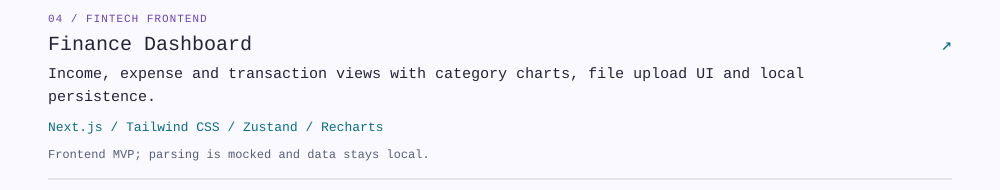
</picture>
</a>

<a href="https://github.com/araxis07/Japan-sakura-trails">
<picture>
  <source media="(prefers-color-scheme: dark) and (max-width: 600px)" srcset="assets/index/dark/mobile/project-05.svg" />
  <source media="(max-width: 600px)" srcset="assets/index/light/mobile/project-05.svg" />
  <source media="(prefers-color-scheme: dark)" srcset="assets/index/dark/desktop/project-05.svg" />
  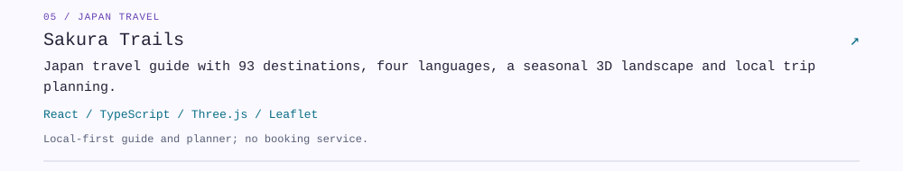
</picture>
</a>

<a href="https://github.com/araxis07/usa-travel-planner">
<picture>
  <source media="(prefers-color-scheme: dark) and (max-width: 600px)" srcset="assets/index/dark/mobile/project-06.svg" />
  <source media="(max-width: 600px)" srcset="assets/index/light/mobile/project-06.svg" />
  <source media="(prefers-color-scheme: dark)" srcset="assets/index/dark/desktop/project-06.svg" />
  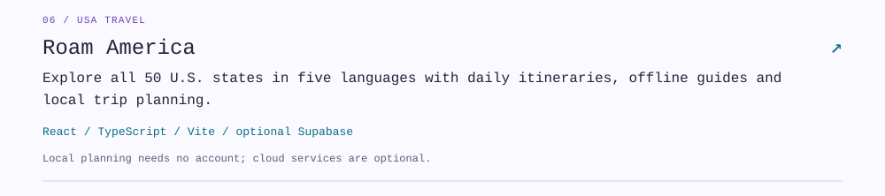
</picture>
</a>

<a href="https://araxis07.github.io"><strong>View case studies on my portfolio →</strong></a>

<strong>More projects from my previous profile</strong>

- [Japan Travel Guide](https://github.com/araxis07/Website-Japan)
- [Sitcam Project](https://github.com/araxis07/Sitcam-Project)

<picture>
  <source media="(prefers-color-scheme: dark) and (max-width: 600px)" srcset="assets/index/dark/mobile/s04.svg" />
  <source media="(max-width: 600px)" srcset="assets/index/light/mobile/s04.svg" />
  <source media="(prefers-color-scheme: dark)" srcset="assets/index/dark/desktop/s04.svg" />
  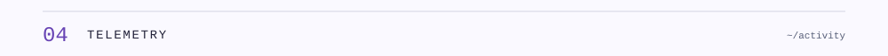
</picture>

<picture>
  <source media="(prefers-color-scheme: dark) and (max-width: 600px)" srcset="assets/index/dark/mobile/signals.svg" />
  <source media="(max-width: 600px)" srcset="assets/index/light/mobile/signals.svg" />
  <source media="(prefers-color-scheme: dark)" srcset="assets/index/dark/desktop/signals.svg" />
  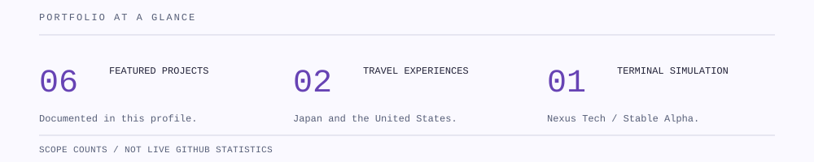
</picture>

<picture>
  <source media="(prefers-color-scheme: dark) and (max-width: 600px)" srcset="assets/index/dark/mobile/s05.svg" />
  <source media="(max-width: 600px)" srcset="assets/index/light/mobile/s05.svg" />
  <source media="(prefers-color-scheme: dark)" srcset="assets/index/dark/desktop/s05.svg" />
  
</picture>

<picture>
  <source media="(prefers-color-scheme: dark) and (max-width: 600px)" srcset="assets/index/dark/mobile/route.svg" />
  <source media="(max-width: 600px)" srcset="assets/index/light/mobile/route.svg" />
  <source media="(prefers-color-scheme: dark)" srcset="assets/index/dark/desktop/route.svg" />
  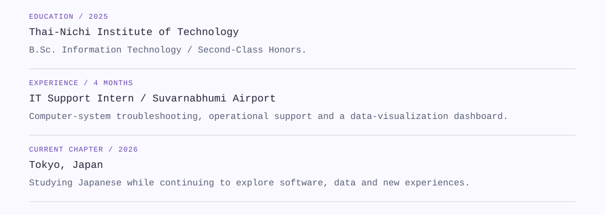
</picture>

<picture>
  <source media="(prefers-color-scheme: dark) and (max-width: 600px)" srcset="assets/index/dark/mobile/s06.svg" />
  <source media="(max-width: 600px)" srcset="assets/index/light/mobile/s06.svg" />
  <source media="(prefers-color-scheme: dark)" srcset="assets/index/dark/desktop/s06.svg" />
  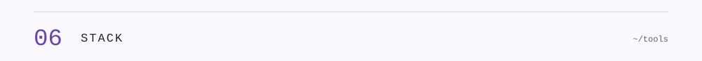
</picture>

<picture>
  <source media="(prefers-color-scheme: dark) and (max-width: 600px)" srcset="assets/index/dark/mobile/stack.svg" />
  <source media="(max-width: 600px)" srcset="assets/index/light/mobile/stack.svg" />
  <source media="(prefers-color-scheme: dark)" srcset="assets/index/dark/desktop/stack.svg" />
  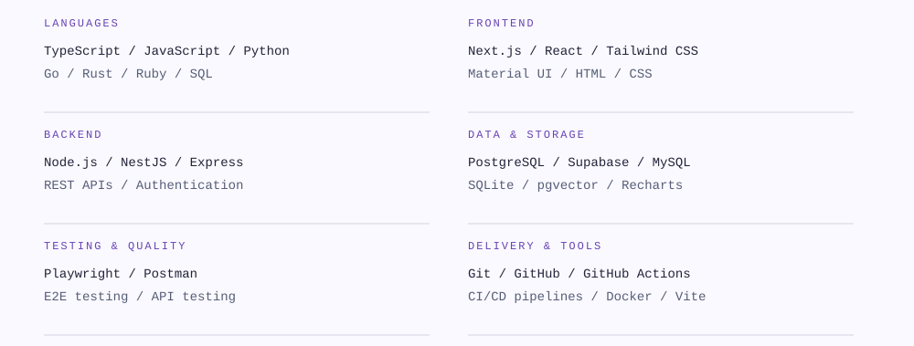
</picture>

<strong>Additional technologies</strong>

 

Technologies also listed in my previous profile:

`Python` `Java` `C` `C++` `C#` `Ruby` `Vue` `Angular` `Flutter` `Redux` `Chart.js` `FastAPI` `Flask` `MongoDB` `NumPy` `TensorFlow` `AWS` `Linux` `Vercel` `Figma` `Arduino` `Unity`

Go and Rust are part of my ongoing learning.

<picture>
  <source media="(prefers-color-scheme: dark) and (max-width: 600px)" srcset="assets/index/dark/mobile/footer.svg" />
  <source media="(max-width: 600px)" srcset="assets/index/light/mobile/footer.svg" />
  <source media="(prefers-color-scheme: dark)" srcset="assets/index/dark/desktop/footer.svg" />
  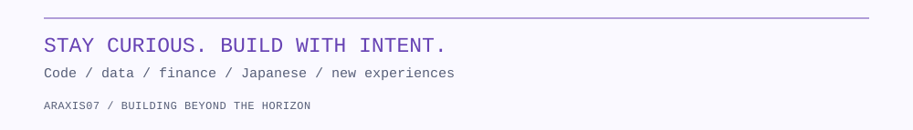
</picture>

  <a href="mailto:pavornprat.aa@gmail.com">Start a conversation</a> ·
  <a href="https://canva.link/j33ybwperioom0j">View resume</a> ·
  <a href="https://araxis07.github.io">Visit portfolio</a> ·
  <a href="https://github.com/araxis07?tab=repositories">Explore code</a>

