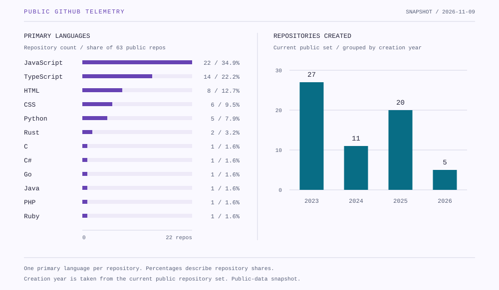
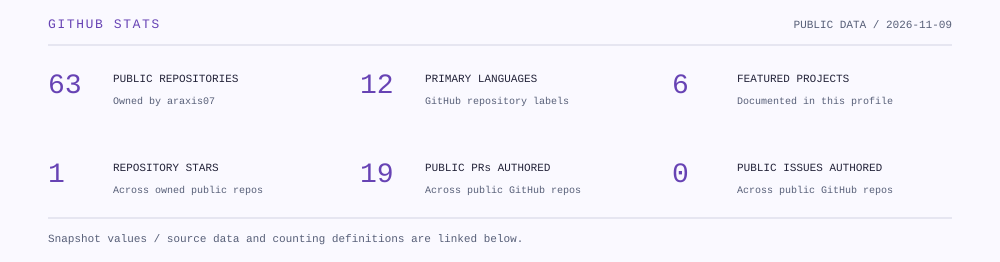

<!-- ARAXIS07 / Developer Index. Generated by scripts/build_profile.py. -->

<picture>
  <source media="(prefers-color-scheme: dark)" srcset="assets/index/dark/desktop/header.svg" />
  
</picture>

 

**Pavornprat Mokarat (Aon) · Full-Stack Developer**

I build web products, backend workflows, and data-rich interfaces with Next.js, React, TypeScript, Node.js, PostgreSQL, and Supabase. B.Sc. Information Technology, Thai-Nichi Institute of Technology · Second-Class Honors · GPAX 3.45.

**Start with a case study:** [Siam Luxe — full-stack workflows](https://araxis07.github.io/#case-study-siam) · [AI Knowledge Base — document retrieval](https://araxis07.github.io/#case-study-ai) · [Roam America — travel planning](https://araxis07.github.io/#case-study-usa)

[Contact me](mailto:pavornprat.aa@gmail.com) · [LinkedIn](https://www.linkedin.com/in/pavornprat/)

<picture>
  <source media="(prefers-color-scheme: dark)" srcset="assets/index/dark/desktop/s01.svg" />
  
</picture>

<picture>
  <source media="(prefers-color-scheme: dark)" srcset="assets/index/dark/desktop/whoami.svg" />
  
</picture>

<picture>
  <source media="(prefers-color-scheme: dark)" srcset="assets/index/dark/desktop/s02.svg" />
  
</picture>

<picture>
  <source media="(prefers-color-scheme: dark)" srcset="assets/index/dark/desktop/ecosystem.svg" />
  
</picture>

<strong>Explore the project branches</strong>

- **Web Products:** [Siam Luxe](https://github.com/araxis07/Siam-Luxe) · [AI Knowledge Base](https://github.com/araxis07/AI-Knowledge)
- **Data Interfaces:** [Finance Dashboard](https://github.com/araxis07/finance-dashboard)
- **Travel Experiences:** [Sakura Trails](https://github.com/araxis07/Japan-sakura-trails) · [Roam America](https://github.com/araxis07/usa-travel-planner)
- **Terminal Systems:** [Nexus Tech](https://github.com/araxis07/Nexus-Tech)

<picture>
  <source media="(prefers-color-scheme: dark)" srcset="assets/index/dark/desktop/s03.svg" />
  
</picture>

<a href="https://github.com/araxis07/Siam-Luxe">
<picture>
  <source media="(prefers-color-scheme: dark)" srcset="assets/index/dark/desktop/project-01.svg" />
  
</picture>
</a>

<strong>Siam Luxe · role, engineering &amp; evidence</strong>

**My role**

I designed the product structure and user flows, implemented the frontend, integrated authentication and database-backed workflows, and built the admin and QA foundations.

**Engineering**

Next.js and TypeScript provide the application architecture; Supabase Auth and PostgreSQL power real workflows; SQL migrations, validation, rate-limiting foundations, Playwright, and GitHub Actions support reliability.

**Scope**

ROLE: Independent full-stack developer · SCOPE: Customer + admin product · QUALITY: Playwright E2E + CI

**Delivered**

- Multilingual customer experience
- Orders, reservations, reviews, favorites, and loyalty flows
- Member profiles and operational admin tooling

**Current status**

The main product foundation is implemented. Live provider setup, deployment, and production operations remain before a public demo can be offered.

**Interface screenshots**

 Reservation calendar · automated visual test snapshot

 Gift cards · automated visual test snapshot

[View source code](https://github.com/araxis07/Siam-Luxe) · [Read this case study](https://araxis07.github.io/#case-study-siam)

<a href="https://github.com/araxis07/AI-Knowledge">
<picture>
  <source media="(prefers-color-scheme: dark)" srcset="assets/index/dark/desktop/project-02.svg" />
  
</picture>
</a>

<strong>AI Knowledge Base · role, engineering &amp; evidence</strong>

**My role**

I built the application structure, protected workspace experience, ingestion pipeline, retrieval layer, role model, operational surfaces, and automated quality checks.

**Engineering**

Next.js handles the application shell and server workflows. Supabase provides Auth, Storage, Realtime, PostgreSQL, and row-level security, while pgvector and full-text search support hybrid retrieval.

**Scope**

ARCHITECTURE: Modular monolith · ACCESS: Four workspace roles · RETRIEVAL: Vector + full-text

**Delivered**

- PDF, Markdown, and plain-text ingestion
- Grounded Q&A with document citations
- Workspace roles, activity logs, health checks, and CI

**Current status**

Core product flows are implemented. Live AI answers and semantic indexing require provider credentials; invitation and durable worker-queue workflows remain limited.

[View source code](https://github.com/araxis07/AI-Knowledge) · [Read this case study](https://araxis07.github.io/#case-study-ai)

<a href="https://github.com/araxis07/Nexus-Tech">
<picture>
  <source media="(prefers-color-scheme: dark)" srcset="assets/index/dark/desktop/project-03.svg" />
  
</picture>
</a>

<strong>Nexus Tech · role, engineering &amp; evidence</strong>

**My role**

I designed and engineered the simulation systems, terminal experience, content model, persistence, campaigns, progression, and release evidence as an independent project.

**Engineering**

Python powers a deterministic simulation core, Rich and Typer provide the terminal interface, SQLite stores compatible saves, and JSON keeps scenario content separate from game logic.

**Scope**

STATUS: Stable Alpha · CONTENT: Six featured campaigns · CATALOG: 50 scenarios

**Delivered**

- Turn-based company, product, market, team, and finance systems
- Offline saves, authored endings, archive progression, and Empire Mode
- Reusable scenarios, templates, rival archetypes, and automated CI

**Current status**

The local gameplay loop is complete at Stable Alpha. Human playtest sessions and final pacing validation are still required before Beta classification.

[View source code](https://github.com/araxis07/Nexus-Tech) · [Read this case study](https://araxis07.github.io/#case-study-nexus)

<a href="https://github.com/araxis07/finance-dashboard">
<picture>
  <source media="(prefers-color-scheme: dark)" srcset="assets/index/dark/desktop/project-04.svg" />
  
</picture>
</a>

<strong>Finance Dashboard · role, engineering &amp; evidence</strong>

**My role**

I designed and implemented the frontend architecture, responsive dashboard, transaction workflow, category visualizations, upload experience, and local persistence.

**Engineering**

Next.js provides the application structure, Tailwind CSS supports responsive presentation, Zustand manages client state, and Recharts communicates expense patterns.

**Scope**

SCOPE: Frontend MVP · STATE: Zustand + local storage · VISUALS: Responsive charts

**Delivered**

- Balance, income, and expense overview
- Transaction management and category analytics
- PDF, spreadsheet, and image upload preparation

**Current status**

This is intentionally a frontend-only MVP. Data is stored locally, while OCR parsing, database integration, and investment recommendations remain future work.

[View source code](https://github.com/araxis07/finance-dashboard) · [Read this case study](https://araxis07.github.io/#case-study-finance)

<a href="https://github.com/araxis07/Japan-sakura-trails">
<picture>
  <source media="(prefers-color-scheme: dark)" srcset="assets/index/dark/desktop/project-05.svg" />
  
</picture>
</a>

<strong>Sakura Trails · role, engineering &amp; evidence</strong>

**My role**

I designed and engineered the product architecture, multilingual content model, search and discovery experience, local-first planner, routing, interactive maps, 3D scene, and quality workflow.

**Engineering**

React and TypeScript power the interface; Vite, server rendering, and esbuild produce localized static pages; Three.js creates the seasonal landscape; Leaflet and OpenStreetMap provide consent-based maps.

**Scope**

CONTENT: 93 destinations · LOCALIZATION: Four languages · DELIVERY: 436 prerendered pages

**Delivered**

- Nine regions, 93 destinations, and nine suggested journeys
- Search, filters, bookmarks, trip planning, sharing, and validated backups
- Responsive images, accessibility checks, Playwright coverage, and CI

**Current status**

The feature-rich local-first implementation is complete. A real public deployment URL, native-speaker proofreading, and remaining editorial verification are required before a production launch.

[View source code](https://github.com/araxis07/Japan-sakura-trails) · [Read this case study](https://araxis07.github.io/#case-study-sakura)

<a href="https://github.com/araxis07/usa-travel-planner">
<picture>
  <source media="(prefers-color-scheme: dark)" srcset="assets/index/dark/desktop/project-06.svg" />
  
</picture>
</a>

<strong>Roam America · USA Travel Planner · role, engineering &amp; evidence</strong>

**My role**

I designed and engineered the product architecture, multilingual content model, discovery experience, state and place guides, daily planner, offline workflow, optional cloud trips, and quality pipeline.

**Engineering**

React 19 and TypeScript power the interface; Vite produces localized static pages; Leaflet supports maps; browser storage and a service worker enable local-first planning; optional Supabase services add account copies and expiring shared snapshots.

**Scope**

CONTENT: 50 states · 150 places · LOCALIZATION: Five languages · DELIVERY: 1,005 prerendered pages

**Delivered**

- 50 state guides, 150 place profiles, and 450 credited local photographs
- Search, filters, favorites, comparison, route-aware daily planning, backups, printing, and offline reading
- Five-language interfaces, optional cloud sharing, a local Content Studio, Playwright, axe, and CI

**Current status**

The feature-rich local-first build is implemented and verified. Public hosting, production environment configuration, and activation of the optional Supabase account services remain before launch.

**Interface screenshots**

 Discovery homepage · captured from Roam America v3

 Daily itinerary workspace · captured from Roam America v3

[View source code](https://github.com/araxis07/usa-travel-planner) · [Read this case study](https://araxis07.github.io/#case-study-usa)

<a href="https://araxis07.github.io"><strong>View case studies on my portfolio →</strong></a>

<strong>More projects from my previous profile</strong>

- [Japan Travel Guide](https://github.com/araxis07/Website-Japan)
- [Sitcam Project](https://github.com/araxis07/Sitcam-Project)

<picture>
  <source media="(prefers-color-scheme: dark)" srcset="assets/index/dark/desktop/s04.svg" />
  
</picture>

<picture>
  <source media="(prefers-color-scheme: dark)" srcset="assets/index/dark/desktop/telemetry.svg" />
  
</picture>

<picture>
  <source media="(prefers-color-scheme: dark)" srcset="assets/index/dark/desktop/github-stats.svg" />
  
</picture>

<strong>Data sources and counting definitions</strong>

- [Public GitHub snapshot and source URLs](data/github-stats.json)
- Language shares count each current public repository once, using GitHub's primary-language label.
- Creation-year bars group the current public repositories by their creation date.
- Stars cover owned public repositories; authored PR and issue totals cover public GitHub repositories.
- [How to refresh the snapshot](docs/telemetry.md)

<picture>
  <source media="(prefers-color-scheme: dark)" srcset="assets/index/dark/desktop/s05.svg" />
  
</picture>

<picture>
  <source media="(prefers-color-scheme: dark)" srcset="assets/index/dark/desktop/route.svg" />
  
</picture>

<strong>Selected credentials, competitions &amp; languages</strong>

**Credentials & competitions**

- 2024 — Cybersecurity Foundation & Professional — NCSA
- 2024 — Innovative Application for Smart Life — Hackathon training
- 2023 — Introduction to Artificial Intelligence — IBM / Coursera
- 2022 — Kaizen Contest — Final 8

**Languages**

- **Thai:** Native
- **English:** Working proficiency
- **Japanese:** Intermediate · JLPT N2 goal

<picture>
  <source media="(prefers-color-scheme: dark)" srcset="assets/index/dark/desktop/s06.svg" />
  
</picture>

<picture>
  <source media="(prefers-color-scheme: dark)" srcset="assets/index/dark/desktop/stack.svg" />
  
</picture>

**Core:** Next.js · React · TypeScript · JavaScript · Node.js · Tailwind CSS · PostgreSQL · Supabase

**Supporting tools & languages:** Python · Ruby · SQL · Git / GitHub · Playwright · Postman · GitHub Actions · CI/CD pipelines

**Ongoing learning:** Go · Rust. The project details above show the technologies used in each build.

<strong>Additional technologies</strong>

 

`Python` `Java` `C` `C++` `C#` `Ruby` `Vue` `Angular` `Flutter` `Redux` `Chart.js` `FastAPI` `Flask` `MongoDB` `NumPy` `TensorFlow` `AWS` `Linux` `Vercel` `Figma` `Arduino` `Unity`

Go and Rust are part of my ongoing learning.

<picture>
  <source media="(prefers-color-scheme: dark)" srcset="assets/index/dark/desktop/footer.svg" />
  
</picture>

  <a href="mailto:pavornprat.aa@gmail.com">Start a conversation</a> ·
  <a href="https://canva.link/j33ybwperioom0j">View resume</a> ·
  <a href="https://araxis07.github.io">Visit portfolio</a> ·
  <a href="https://github.com/araxis07?tab=repositories">Explore code</a> ·
  <a href="https://www.linkedin.com/in/pavornprat/">LinkedIn</a>

